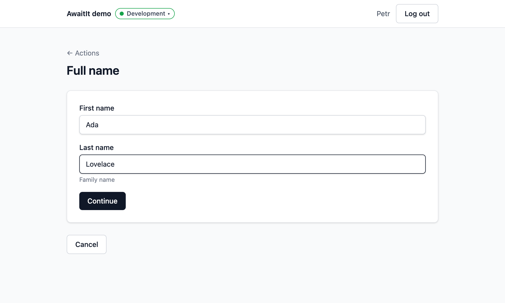

# AwaitIO

Internal tools in one Node process. Write each tool as an async TypeScript function; every `await` on `io` asks a person something in the browser and waits for the answer. The same server serves the UI, so there is nothing else to host.

```ts
export const refundOrderAction = app.defineAction({
  name: 'Refund order',
  handler: async ({ io, ctx }) => {
    const orderId = await io.input.text('Order ID');
    const order = await prisma.order.findUniqueOrThrow({ where: { id: orderId } });
    const reason = await io.input.textarea(`Why refund ${formatMoney(order.total)}?`);

    await prisma.refund.create({ data: { orderId, reason, approvedBy: ctx.user.email } });

    return { refunded: formatMoney(order.total) };
  },
});
```



## Why AwaitIO

- **One process.** The actions, the server and the UI run inside your own app. No hosted service, no second server, no database of its own.
- **Your codebase.** A handler is a plain function: use your Prisma client, services, utilities and environment variables as they are.
- **Typed end to end.** `io` is typed from the components you register; each component checks its props and its answer with zod on the server.
- **Extensible.** A component is plain React in one file. Write your own and register it next to the built-in ones.
- **Deploys with your app.** Each environment (production, staging, local) is its own server with its own secrets; the header switches between them.
- **Private by default.** Login with email and password (scrypt hashes, signed cookies), runs visible only to the person who started them, the server listens on `127.0.0.1` unless you say otherwise.

## Quickstart

```bash
npm install awaitio @awaitio/theme-default @awaitio/input-text zod
```

```ts
// app.ts
import { inputText } from '@awaitio/input-text';
import { defaultTheme } from '@awaitio/theme-default';
import { AwaitIO } from 'awaitio';
import { join } from 'path';

export const app = new AwaitIO({
  name: 'Internal tools',
  actionsDirectory: join(__dirname, 'actions'), // every file in it is an action, its path is the URL (/actions/greet)
  theme: defaultTheme,
  secret: process.env.SESSION_SECRET!,
  users: [{ email: 'you@example.com', name: 'You', passwordHash: 'scrypt$…' }], // from Create new account on the login page
  components: { input: { text: inputText } },
});

// actions/greetAction.ts
export const greetAction = app.defineAction({
  name: 'Greet',
  handler: async ({ io }) => {
    const name = await io.input.text('Your name');

    return `Hello, ${name}!`;
  },
});

// server.ts
void app.listen({ port: 3000 });
```

Open http://localhost:3000, log in and run **Greet**.

## Packages

| Package                                                                             | What it is                                                                        |
| ----------------------------------------------------------------------------------- | --------------------------------------------------------------------------------- |
| [`awaitio`](https://docs.awaitio.com/core/app)                                      | The server, the action runtime, the prebuilt UI and `defineComponent`             |
| [`@awaitio/theme-default`](https://docs.awaitio.com/core/theme)                     | The default look: every building block of `awaitio/ui`, with its styles           |
| [`@awaitio/input-text`](https://docs.awaitio.com/io/input-text)                     | `io.input.text()`: one line of text                                               |
| [`@awaitio/input-email`](https://docs.awaitio.com/io/input-email)                   | `io.input.email()`: an email address                                              |
| [`@awaitio/input-url`](https://docs.awaitio.com/io/input-url)                       | `io.input.url()`: a web address, returned as a `URL`                              |
| [`@awaitio/input-textarea`](https://docs.awaitio.com/io/input-textarea)             | `io.input.textarea()`: longer text                                                |
| [`@awaitio/input-number`](https://docs.awaitio.com/io/input-number)                 | `io.input.number()`: a number, with min, max and decimal places                   |
| [`@awaitio/input-boolean`](https://docs.awaitio.com/io/input-boolean)               | `io.input.boolean()`: yes or no, with a checkbox                                  |
| [`@awaitio/input-datetime`](https://docs.awaitio.com/io/input-datetime)             | `io.input.datetime()`: a date and time, returned as a luxon `DateTime`            |
| [`@awaitio/input-date`](https://docs.awaitio.com/io/input-date)                     | `io.input.date()`: a date, returned as a luxon `DateTime`                         |
| [`@awaitio/select-single`](https://docs.awaitio.com/io/select-single)               | `io.select.single()`: one of a list of options                                    |
| [`@awaitio/select-single-native`](https://docs.awaitio.com/io/select-single-native) | `io.select.singleNative()`: one of a list of options, in a native drop-down       |
| [`@awaitio/select-multiple`](https://docs.awaitio.com/io/select-multiple)           | `io.select.multiple()`: any number of options                                     |
| [`@awaitio/select-table`](https://docs.awaitio.com/io/select-table)                 | `io.select.table()`: rows picked from a table                                     |
| [`@awaitio/confirm`](https://docs.awaitio.com/io/confirm)                           | `io.confirm()`: Confirm or Cancel before something irreversible                   |
| [`@awaitio/display-table`](https://docs.awaitio.com/io/display-table)               | `io.display.table()` in pages: rows with filter, paging, links and row menus      |
| [`@awaitio/display-metadata`](https://docs.awaitio.com/io/display-metadata)         | `io.display.metadata()` in pages: label and value tiles                           |
| [`@awaitio/display-link`](https://docs.awaitio.com/io/display-link)                 | `io.display.link()`: a link to a page in the app or outside it                    |
| [`@awaitio/display-heading`](https://docs.awaitio.com/io/display-heading)           | `io.display.heading()`: a section title with an optional description              |
| [`@awaitio/display-image`](https://docs.awaitio.com/io/display-image)               | `io.display.image()`: a picture, such as a chart or a file preview                |
| [`@awaitio/display-markdown`](https://docs.awaitio.com/io/display-markdown)         | `io.display.markdown()`: formatted text written in markdown                       |
| [`@awaitio/display-object`](https://docs.awaitio.com/io/display-object)             | `io.display.object()`: the keys and values of a record, nested data included      |
| [`@awaitio/display-html`](https://docs.awaitio.com/io/display-html)                 | `io.display.html()`: HTML markup, sanitized first                                 |
| [`@awaitio/layout-basic`](https://docs.awaitio.com/io/layout-basic)                 | `io.layout.basic()`: the frame of a page, with its title, description and buttons |

## Documentation

The documentation is at **[docs.awaitio.com](https://docs.awaitio.com)**: introduction, quickstart, how it works and security, every setting, routing, pages and layouts, themes, every `io` method and `ctx` field, custom components and deployment. Its source is in [`apps/docs`](apps/docs); run it locally with `pnpm --filter @awaitio/docs dev`.

## Development

Requires Node 22.14 and pnpm.

```bash
pnpm install
cp .env.example .env   # SESSION_SECRET
pnpm dev               # demo at http://localhost:3000, log in with demo@awaitio.com / demo
pnpm test && pnpm lint && pnpm tsc
```

Contributions are welcome; see [CONTRIBUTING.md](CONTRIBUTING.md). Every contributor signs the [CLA](CLA.md) once.

## License

AwaitIO is source-available under the [AwaitIO License](LICENSE). It is free, including commercial use, for up to 3 users and for non-profits and education. Larger teams pay one flat monthly price. Prices, examples and how to get a license are on [awaitio.com/pricing](https://awaitio.com/pricing).

## Inspiration

I'm Petr Homoky ([homoky.cz](https://homoky.cz)), the author of AwaitIO. Before I started on it, I built internal tools with [Interval](https://github.com/interval), and the idea behind it won me over: a tool is just backend code, and every `await` asks a person in the browser. AwaitIO keeps that idea and puts the actions, the server and the UI into one process inside your own app, so there is nothing else to run.
