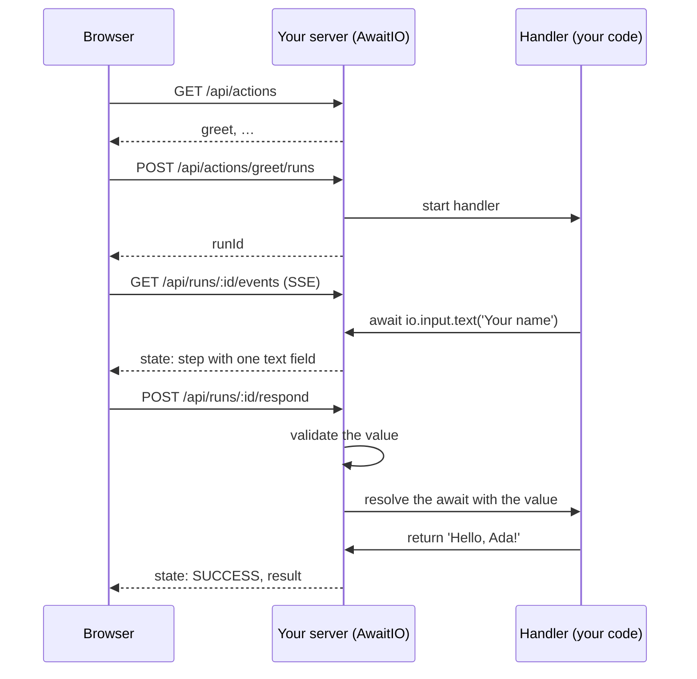

AwaitIO is one Node process. The same server runs your action code, serves the UI and keeps the state of every run. There is no hosted service in between: the browser talks only to your server, and your code, secrets and data never leave it.

## One action, step by step

Take this action:

```ts actions/greetAction.ts
import { app } from '../app';

export const greetAction = app.defineAction({
  name: 'Greet',
  handler: async ({ io }) => {
    const name = await io.input.text('Your name');

    return `Hello, ${name}!`;
  },
});
```



<Steps>
  <Step title="The server starts">
    `app.listen()` loads every file in the `actionsDirectory` folder given to `new AwaitIO()` and opens the `port`. A file's path becomes the action's URL: `actions/greetAction.ts` is at `/actions/greet`.
  </Step>
  <Step title="The UI lists the actions">
    After login the UI asks `GET /api/actions` for the name, description and slug of every action. Nothing else about the action, and none of its code, reaches the browser.
  </Step>
  <Step title="A run starts">Opening an action sends `POST /api/actions/:slug/runs`. The server creates a run and calls your handler as a plain async function.</Step>
  <Step title="The handler waits on io">
    `await io.input.text('Your name')` does not block anything else: the handler's promise is parked on the run until someone answers. The run's state now holds a step with one text field.
  </Step>
  <Step title="The step reaches the browser">
    The page follows the run over server-sent events at `GET /api/runs/:id/events`. On every (re)connect the server first sends the current state, so a refresh or a dropped connection picks up where
    it was.
  </Step>
  <Step title="The answer is checked on the server">
    The form sends `POST /api/runs/:id/respond` with the values. The server parses each value with the component's schema and runs its `validate`. An invalid value never reaches your handler: the same
    step comes back with the error under the field.
  </Step>
  <Step title="The handler goes on">A valid answer resolves the parked promise, `name` gets the value and the handler continues to the next `await io` or to its `return`.</Step>
  <Step title="The result is shown">The return value is sent to the page as the run's result. A thrown error ends the run as a failure, and its name and message are shown instead.</Step>
</Steps>

The tab icon follows the run, so a background tab tells the person when it is their turn: its arc fills up with an orange dot while the handler works, it stops with the orange dot while a step waits for an answer, and it is plain otherwise.

## Where runs live

Runs exist only in the server's memory.

- **Refresh or a dropped connection** keeps the run: the page reconnects and gets the current state.
- **A closed page** cancels the run after 30 seconds without any page following it. The same grace period applies to a run that no page ever opened. A canceled handler gets an error at its pending or next `io` call.
- **A finished run** stays available for 15 minutes, then it is removed. Its URL no longer works after that.
- **A restart or a deploy** ends every running action. A handler is a live closure in memory and cannot be saved anywhere.

## Security

### Everything stays in your process

There is no AwaitIO service. Your action code, environment variables and the data your handlers load run only on your server. The browser receives exactly what `io` calls and return values send it, and nothing is forwarded to a third party.

|                                         | Visible to the browser                       | Stored by AwaitIO                                       |
| --------------------------------------- | -------------------------------------------- | ------------------------------------------------------- |
| Action names and descriptions           | Yes, to logged-in users                      | No, they live in your code                              |
| Source code and business logic          | No                                           | No                                                      |
| Secrets and environment variables       | No                                           | No                                                      |
| Values shown or asked for by `io` calls | Yes, to the user of that run                 | In memory while the run lasts, never on disk or in logs |
| Return values and error messages        | Yes, to the user of that run                 | In memory for 15 minutes after the run ends             |
| Users and password hashes               | Only the logged-in user's own email and name | No, they come from your configuration                   |

AwaitIO has no database and writes nothing to disk. The server does not log `io` values, return values or anything else.

### Who can use it

- **Login:** without a valid session the API and the component scripts answer `401`; only the login page, `/health` and the project name are public. See [Users](/core/users) for passwords, sessions and lockout.
- **Runs are private:** a run belongs to the user who started it. Its page, its answers and canceling it are open only to that user; anyone else gets `404`.
- **Environments:** the login page shows only the current environment. The URLs of the other environments are sent only to logged-in users.
- **Only this machine by default:** `app.listen()` binds to `127.0.0.1` unless you pass another `host`.

### Requests from other sites

- Every API request that changes something must carry the `X-AwaitIO-Request: 1` header and a JSON body. A page on another origin cannot send that header without a CORS preflight, which the server never allows. Requests whose `Sec-Fetch-Site` is anything other than `same-origin` get `403` as well.
- The session cookie is `HttpOnly` and `SameSite=Strict`.
- Every response sets `X-Frame-Options: DENY` and `Content-Security-Policy: frame-ancestors 'none'`, so no other page can frame the UI and trick a user into clicking through a step. `X-Content-Type-Options: nosniff` and `Referrer-Policy: no-referrer` are set too.

### The browser cannot skip validation

Components are checked on the server: every answer is parsed with the component's schema and passed through its `validate` before the handler sees it. The browser's own checks, such as a `required` field, only save a round trip. A modified browser or a hand-written request cannot hand your handler a value the component would reject.
